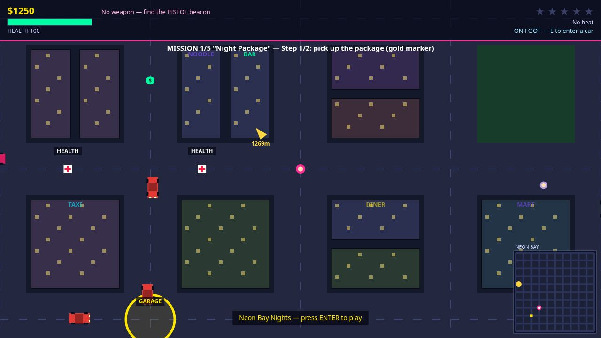

[](https://make.fun/bounty/gta6-01?utm_source=github&utm_medium=readme&utm_campaign=gta6-01)
[](https://make.fun/bounty/gta6-01/leaderboard?utm_source=github&utm_medium=readme&utm_campaign=gta6-01)
[](https://make.fun/bounty/gta6-01?utm_source=github&utm_medium=readme&utm_campaign=gta6-01)

# Neon Bay Nights

Neon Bay Nights drops you into a sunlit coastal city at golden hour and hands you a simple arrangement: a fixer named Marlowe has work, the streets are full of cars worth taking, and Bay PD would rather you did none of it. You alternate between running on foot and driving, follow glowing markers from one errand to the next, and decide for yourself how much attention to attract along the way. Everything runs in the browser from plain static files — the 3D city, the traffic, the police, the sound, and your saved progress all live locally, with no account and no network needed once the page has loaded.

## The work

Marlowe's storyline is a chain of ten jobs that unlock one after another, each paying more than the last. Early jobs teach the loop gently — pick up a parked convertible near the water and bring it back undamaged, or carry a parcel across town against a countdown. Later jobs stack the pressure: multi-stop cash collections, deliveries that span all four districts in a single run, and thefts that summon a heavy police response the moment you touch the door handle. Some stages ask you to simply reach a place, some ask you to arrive in a specific stolen car, and the escape stages only count once you have reached the garage ring and the wanted level has fully cooled. A floating arrow over your character and a pulsing marker in the world always point at the current objective, and Marlowe talks you through each step in a dialogue box at the bottom of the screen. Finishing the tenth job opens the city up for free roaming.

## The city

The map is a compact grid of avenues and streets with the beach, the ocean, and a wooden pier along the eastern edge. Four districts give each corner its own character: Downtown packs the tallest towers, the Beachfront lines the boulevard with low hotels and palm trees, Old Town sits to the west, and the Marina tucks sailboats into the south-east corner. Neon signs, lit windows, street lamps, working traffic lights, parks with benches, a hospital, and Bay Garage fill out the blocks between the roads. Completing a job raises your standing in the district where that job began, and the interface keeps a running tally of respect for all four areas so you can watch your reputation spread across the map.

## Cars and driving

Eight civilian models circulate through the city, each with its own top speed and acceleration: the Sunset Sedan, Bay Cruiser, Palm GT, Marina Hatch, Neon Coupe, Beach Buggy, Old Town Pickup, and Sol Convertible. Around two dozen of them are always driving the grid — keeping to lanes, braking for anything in front of them, and turning at intersections — while more sit parked along the kerbs waiting to be borrowed. Driving is deliberately forgiving: steering answers even at crawling pace, the handbrake tightens turns, and collisions dent the bodywork rather than ending the run. Damage shows up as smoke from the bonnet and, once a car is badly beaten up, a lower top speed. Police interceptors use the same driving model with light bars, a livery stripe, and sirens.

## On foot

Out of a car you can walk, sprint, and fight. Four weapon slots sit on number keys 1 to 4: bare fists and a pistol from the start, with a submachine gun and a shotgun earned through story progress or found as glowing pickups around the city, alongside health and armour pickups. Aiming uses the mouse with pointer lock, and attacks land on pedestrians and vehicles alike — bystanders scatter when shots ring out. Health and armour bars track how much punishment you can take; running out of health flashes a wasted screen and wakes you up outside the hospital with your wanted level cleared and a fresh four seconds of protection.

## Bay PD

Trouble is measured in heat, displayed as up to five stars. Each star level has a named dispatch tier — Patrol, Interceptor, Roadblock, Air Support, and Maximum Response — fielding one, two, three, four, and six ground units respectively. Officers drive with distinct habits, some charging straight at you and others swinging wide to cut you off, and from two stars they open fire at close range. At three stars the response changes character: roadblocks appear on the road ahead of you and a helicopter joins the chase, orbiting overhead with a spotlight that tracks your position. The pursuit is tuned so it can pressure you without ever trapping you — officers keep a standoff distance and get pushed aside rather than pinning your car in place. Break contact for a while and the heat drains away; reach the glowing ring at Bay Garage and it clears instantly for a fifty-dollar fee.

## Interface, sound, and saving

The heads-up display is built around the job: a mission card shows the current objective, what comes next, and any countdown, while a dispatch panel lists every responding unit by callsign with its distance and tactic. Cash, the in-game clock, and your stars sit top-right; the district name, respect totals, and radio station sit top-centre; weapon slots with ammunition, health and armour bars, and a speedometer with the current vehicle's name and condition fill the right edge. A circular minimap in the corner draws the road grid, the shoreline, the hospital and garage, police units in red, the helicopter in orange, and your objective as a pulsing yellow dot. All audio is synthesized in code — engine hum that follows your speed, wailing sirens, gunshots, crashes, horns, cash chimes, and two radio stations (a synth loop and a talk station) plus an off setting. Progress persists in browser storage between visits: money, story position, district respect, owned weapons and ammunition, and your radio and mute choices.

## Controls

- **W A S D** or arrow keys — move on foot / drive
- **Shift** — sprint on foot
- **Space** — handbrake while driving
- **E** — get into or out of the nearest car
- **Mouse** — aim (click the game to capture the pointer)
- **Click** or **F** — attack with the selected weapon
- **1–4** — select weapon slot
- **R** — cycle radio station
- **H** — horn
- **P** — pause
- **M** — mute

## Screenshots




## Play locally

You need Node 22 and a browser; there is nothing to install. From the repository root, start the bundled static server:

```bash
node serve.ts
```

Then open http://localhost:8080 and press START. The server only serves the `game/` folder on your own machine. You can also open `game/index.html` through any static file host, since the game itself is self-contained — Three.js is vendored under `game/vendor/` and every other asset is generated in code.

## Hand-in

The submission program copies the playable game and the screenshots into an output folder and writes the competition dossier next to them:

```bash
mkdir -p out && MAKEFUN_OUTPUT_DIR=out node main.ts
```

## Layout

- `game/` — the playable game: `index.html` plus the modules in `game/src/` (world, city, vehicles, player, police, missions, HUD, audio, save) and the vendored Three.js build.
- `screenshots/` — four staged captures of the game in action.
- `serve.ts` — the local play server described above.
- `main.ts` — the hand-in program described above, using the library in `vendor/`.
