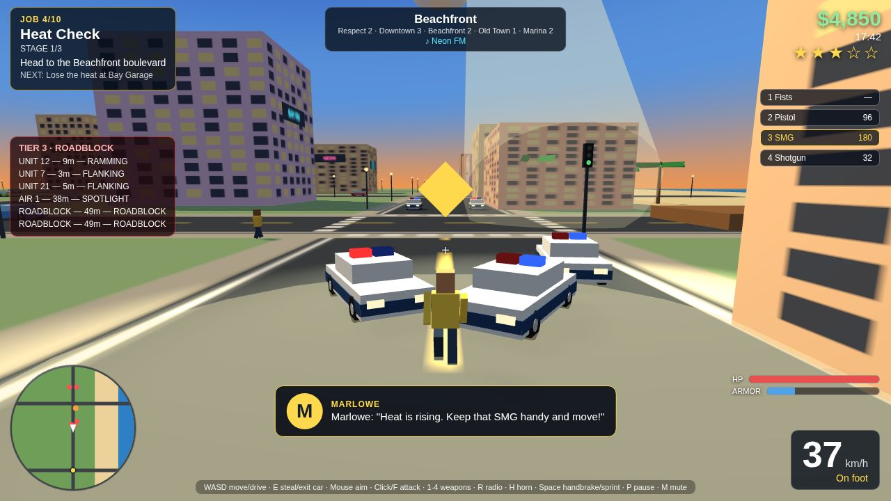
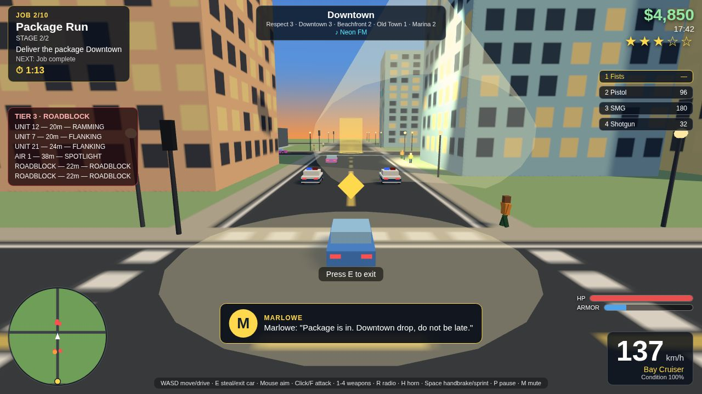
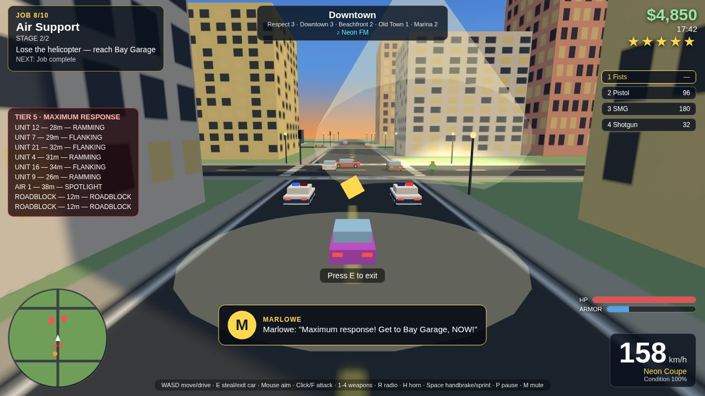

[](https://make.fun/bounty/gta6-01?utm_source=github&utm_medium=readme&utm_campaign=gta6-01)
[](https://make.fun/bounty/gta6-01/leaderboard?utm_source=github&utm_medium=readme&utm_campaign=gta6-01)
[](https://make.fun/bounty/gta6-01?utm_source=github&utm_medium=readme&utm_campaign=gta6-01)

# Neon Bay Nights

A true-3D open-world crime game that runs entirely in the browser. You are a wheelman in Neon Bay, a sunlit coastal city at golden hour, doing jobs for a fixer called Marlowe while Bay PD tries to ruin your day. The whole city is real-time Three.js: low-poly towers, a palm-lined beachfront boulevard, the ocean and a pier to the east, traffic that keeps to its lanes, and pedestrians who scatter when shots ring out. There is no install and no account — open the page, press START, and the city is yours. Everything runs from plain static files, including the vendored Three.js build and the synthesized sound, so it works offline once loaded.

## Ten jobs for Marlowe

Marlowe's storyline is ten jobs that unlock in order and pay more as they get harder: steal a convertible by the Marina, run a parcel across town against a countdown, collect debts at three stops, and finish with a three-stage finale worth $5,000. Jobs mix four stage types — steal a marked car, drive to a place, deliver a car, and escape to the garage — and some thefts summon heat the moment you touch the door handle. A floating arrow above your character and a pulsing beam in the world always mark the objective, and Marlowe talks you through it in the dialogue box. Clear all ten and the city opens up for free roaming.

## Bay PD: five dispatch tiers

Heat is measured in five stars, and every star level fields a named dispatch tier: Patrol (1 unit), Interceptor (2), Roadblock (3), Air Support (4), and Maximum Response (6). Units drive with different habits — some ram you head-on, others swing wide to cut you off — and from two stars they shoot at close range. At three stars the response changes shape: roadblocks appear on the road ahead and a helicopter joins the chase, orbiting overhead with a spotlight that tracks your position. The pursuit is deliberately tuned so it can pressure you without ever trapping you — officers keep a standoff distance, ease off inside eight metres, and get pushed aside instead of pinning your car. Break contact and the heat drains away; reach the glowing ring at Bay Garage and it clears instantly for $50.

## Driving and fighting

Eight civilian models share the roads, each with its own top speed and acceleration: Sunset Sedan, Bay Cruiser, Palm GT, Marina Hatch, Neon Coupe, Beach Buggy, Old Town Pickup, and Sol Convertible. Around two dozen are always driving the grid while more sit parked along the kerbs, waiting to be borrowed — press E next to one and it is yours, at the cost of a little heat. Driving is forgiving arcade: steering answers even at crawling pace, the handbrake tightens turns, and collisions dent bodywork (and eventually smoke) rather than ending the run.

On foot you walk, sprint, and fight with a four-slot weapon wheel on keys 1–4: fists and a pistol from the start, with an SMG and a shotgun earned through the story or found as glowing pickups around the city, next to health and armour pickups. The mouse aims with pointer lock; bystanders flee when shots ring out. Lose all your health and the wasted screen wakes you up outside the hospital with your wanted level cleared.

## Four districts, respect, radio, saves

The map splits into Downtown, Beachfront, Old Town, and Marina, and finishing a job raises your respect in the district where it began — the HUD keeps a running tally for all four. Two radio stations (a synth loop and a talk station, plus off) play from a synthesized engine hum, sirens, gunshots, crashes, horns, and cash chimes. Progress persists in browser storage between visits: money, story position, district respect, owned weapons and ammunition, and your radio and mute choices.

## The HUD

Every edge of the screen is working. Top-left is the mission card: job number, title, stage, objective, what comes next, and any countdown. Under it, the dispatch panel lists every responding unit by callsign with its live distance and tactic, including AIR 1 and roadblocks. Top-right holds money, the clock, and your stars; top-centre the district, respect totals, and radio station. The right edge carries the four weapon slots with ammunition, health and armour bars, and a speedometer with the current vehicle's name and condition. Bottom-left is a circular minimap drawing the road grid, the shoreline, the hospital and garage, police in red, the helicopter in orange, and your objective as a pulsing yellow dot. Marlowe's dialogue sits bottom-centre.

## Controls

- **W A S D** or arrow keys — move on foot / drive
- **Shift** — sprint on foot
- **Space** — handbrake while driving
- **E** — get into or out of the nearest car
- **Mouse** — aim (click the game to capture the pointer)
- **Click** or **F** — attack with the selected weapon
- **1–4** — select weapon slot
- **R** — cycle radio station
- **H** — horn
- **P** — pause
- **M** — mute

## Screenshots








## Play locally

You need Node 22 and a browser; there is nothing to install. From the repository root, start the bundled static server:

```bash
node serve.ts
```

Then open http://localhost:8080 and press START. The server only serves the `game/` folder on your own machine. You can also host `game/index.html` through any static file host, since the game is self-contained — Three.js is vendored under `game/vendor/` and every other asset is generated in code.

## Hand-in

The submission program copies the playable game and the screenshots into an output folder and writes the competition dossier next to them:

```bash
mkdir -p out && MAKEFUN_OUTPUT_DIR=out node main.ts
```

## Layout

- `game/` — the playable game: `index.html` plus the modules in `game/src/` (world, city, vehicles, player, police, missions, HUD, audio, save) and the vendored Three.js build.
- `screenshots/` — four staged captures of the game in action.
- `serve.ts` — the local play server described above.
- `main.ts` — the hand-in program described above, using the library in `vendor/`.
